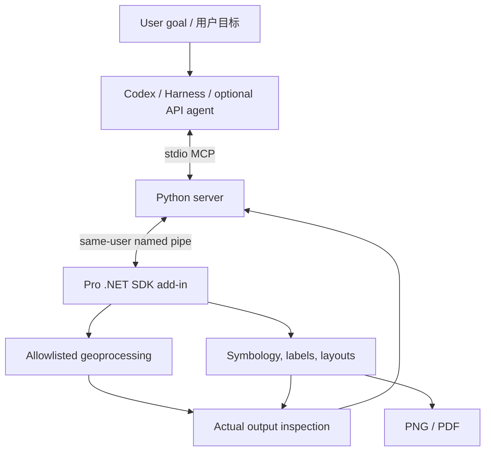

# Architecture / 架构

The agent host owns the conversation, model credentials and reasoning loop. Codex and Harness load a plugin that starts a local stdio MCP server. The optional standalone UI can start a Codex runner, Harness runner or a Chat Completions compatible API agent.

Agent 宿主负责对话、模型认证和决策循环；Codex/Harness 插件启动本地 stdio MCP 服务。可选桌面界面也可启动 Codex、Harness 或 Chat Completions 兼容 API 引擎。

Named pipes are scoped to the current Windows user. Discovery metadata is under `%LOCALAPPDATA%\ArcGISProCodex\endpoints`. The server filters live processes. Calls bind to process ID, map URI and, for analysis, a snapshot. Refresh context after jobs or styling; stale references are rejected. Pro does not make a second model request.

命名管道限当前 Windows 用户，发现元信息位于 `%LOCALAPPDATA%\ArcGISProCodex\endpoints`。服务筛选存活进程，调用绑定进程、地图 URI 和分析快照；处理或样式变更后需刷新上下文，拒绝旧引用。Pro 不再发起第二次模型请求。

## MCP tools / 工具

| Tool | Function / 功能 |
| --- | --- |
| `list_sessions` | Discover live Pro bridge sessions / 查找桥接会话 |
| `get_active_map` | Read map, CRS and layer metadata / 读取地图及图层 |
| `draw_graphics` | Explicit WGS84 temporary points/lines/polygons / 明确经纬度的临时绘图 |
| `zoom_to_graphics` | Zoom to bridge overlays / 定位叠加 |
| `clear_graphics` | Clear bridge overlays / 清除叠加 |
| `get_analysis_context` | Inputs, snapshots and operation catalog / 输入、快照、操作清单 |
| `inspect_layer` | Actual counts, fields or raster statistics / 实际数量、字段、栅格统计 |
| `start_analysis` | Submit allowlisted background jobs / 提交后台分析 |
| `get_analysis_job` | Observe job states and outputs / 查看状态和输出 |
| `cancel_analysis_job` | Request cancellation / 请求取消 |
| `style_raster` | Raster colors, classes, opacity / 栅格样式 |
| `set_layer_presentation` | Layer order, names, line symbols and labels / 图层展示 |
| `set_layer_visibility` | Hide/show layers / 显隐 |
| `export_map` | Layout, PNG/PDF and saved project / 布局导出及保存 |

The processing catalog in `mcp/analysis-schema.json` contains the authoritative parameter definitions. Operations include vector copy/project/buffer/overlay/dissolve/merge, selections, spatial join, statistics; raster projection/resampling/clipping; slope/aspect/hillshade/contour/reclassification; fill/flow/watershed; density, zonal statistics, extraction, IDW and arithmetic. Actual availability depends on data and ArcGIS licensing.

参数以 `mcp/analysis-schema.json` 为准。操作包含矢量复制、投影、缓冲、叠置、融合、合并、选择、空间连接和统计，以及栅格投影、重采样、裁剪、地形、水文、密度、分区统计、值提取、IDW 和算术。可用性仍取决于数据和许可。

No arbitrary model-generated scripts are accepted. Processing produces new datasets; cancellation does not undo completed work. Graphics overlays are temporary. Exported PDF pages use rasterized map content to avoid transparency seams; they are not a promise of fully editable vector output. Basic labeling/layout support is not universal cartographic automation.

不接收任意模型脚本。处理生成新数据，取消不会撤销已完成操作。绘图叠加是临时的；PDF 地图内容使用栅格化以避免透明拼接问题，不承诺全矢量可编辑。基础标注与布局不能等同通用自动制图。
